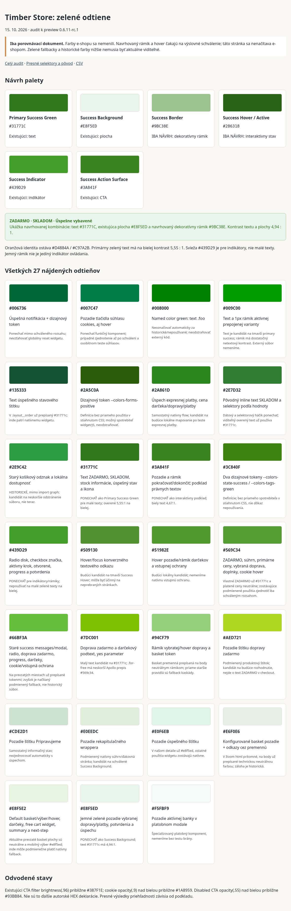

# Timber Store: audit zelených farieb a mobilná doprava

15. 10. 2026 · pracovná vetva `preview/mobile-shipping-layout-20261015` · preview `0.6.11-rc.1` · základ `fb75c3ef6351fb56cdd11c7d0d67c795b9b53cf4`.

**Farby e-shopu sa nemenili.** Jediná zmena prezentačného zdroja je mobilné rozloženie v `src/styles/overrides/checkout.css`. `src/styles/tokens.css` je byte-identický s tagom v0.6.9. Produkčný loader zostáva v0.6.9, predchádzajúci preview commit je zachovaný. Bez merge, produkčného nasadenia alebo nového release tagu. Trello kód nebol dodaný; pokračuje existujúca autorizovaná preview vetva.

## Výsledok auditu

Nájdených **27 presných zelených odtieňov** a **161 záznamov** deklarácií, premenných, inline/config hodnôt a selektorových háčikov. Z toho sú štyri vlastné aktívne farebné hodnoty: `#31771c`, `#3a841f`, `#439d29`, `#e8f5ed`. Pôvodná dostupnosť `#2e7d32` je dátový/selektorový háčik; viditeľný overený text už používa `#31771c`. Starý `#2e9c42` patrí neimportovanému list-view. Ostatné odtiene sú natívne Apollo/Shoptet, konfigurácia alebo tretia strana.

- [Kompletná tabuľka všetkých výskytov vrátane selektorov](inventory.md)
- [CSV so všetkými deklaráciami, pôvodným zápisom, rozbalením premenných a stavom](inventory.csv)
- [Vizuálne vzorky aktuálnych farieb a navrhovanej palety](swatches.html) – samostatný dokument, nenačítava sa e-shopom.
- [Pozorované výsledné computed štýly](observed.csv)
- [Rozsah skenovania a kontrolné súčty](sources.md)

Pri CSS premenných uvádzame aj zelené fallbacky/alternatívy, ktoré dnes vyhrávajúci neutrálny token prepíše. Samotný výskyt v externom CSS preto neznamená aktuálne zelený prvok. Historické súbory odlišujeme podľa importov; nenačítaný stav stránky neoznačujeme za dôkaz nepoužívania pravidla.

## Prehľad všetkých odtieňov

| Farba HEX/RGBA | Použitie | Stránka/komponent | Zdrojový súbor | Pôvod, účinnosť a odporúčanie |
|---|---|---|---|---|
| #006736 | Úspešná notifikácia + dizajnový token | Natívny objednávkový/vratkový shadow widget | `Shoptet order-component.js [shadow CSS]:1` | Shoptet – natívny objednávkový widget — Ponechať mimo schváleného rozsahu; nevzťahovať globálny reset widgetu. |
| #007c47 | Pozadie tlačidla súhlasu cookies, aj hover | Shoptet cookie settings | [Apollo main.css:46](https://cdn.myshoptet.com/usr/apollo.jakubtursky.sk/user/documents/assets/main.css?v=1864) | Apollo/Shoptet — Ponechať funkčný komponent; prípadné zjednotenie až po schválení a osobitnom teste súhlasov. |
| #008000 | Named color green: text .foo | Externý Apollo CSS, bez pozorovaného matchu | [Apollo main.css:46](https://cdn.myshoptet.com/usr/apollo.jakubtursky.sk/user/documents/assets/main.css?v=1864) | Apollo/Shoptet — Neoznačovať automaticky za historické/nepoužívané; neodstraňovať externý kód. |
| #009c00 | Text a 1px rámik aktívnej prepojenej varianty | Webotvůrci product interconnection | [all.min.css?v=29:1](https://cdn.myshoptet.com/usr/webotvurci.myshoptet.com/user/documents/plugin-product-interconnection/css/all.min.css?v=29) | Tretia strana – Webotvůrci — Text je kandidát na tmavší primary success; rámik má dostatočný netextový kontrast. Externý súbor nemeníme. |
| #135333 | Text úspešného stavového štítku | Natívny order widget .flag--success | `Shoptet order-component.js [shadow CSS]:1` | Shoptet – natívny objednávkový widget — V .layout__order už prepísaný #31771c; inde patrí natívnemu widgetu. |
| #2a5c0a | Dizajnový token --colors-forms-positive | Apollo/Shoptet root | [Apollo main.css:46](https://cdn.myshoptet.com/usr/apollo.jakubtursky.sk/user/documents/assets/main.css?v=1864) | Apollo/Shoptet — Definícia bez priameho použitia v stiahnutom CSS; možný spotrebiteľ widget/JS, neodstraňovať. |
| #2a861d | Úspech expresnej platby, cena darčeka/dopravy/platby | Native .express-checkout | [Apollo main.css:46](https://cdn.myshoptet.com/usr/apollo.jakubtursky.sk/user/documents/assets/main.css?v=1864) | Apollo/Shoptet — Samostatný natívny flow; kandidát na budúce lokálne mapovanie po teste expresnej platby. |
| #2e7d32 | Pôvodný inline text SKLADOM a selektory podľa hodnoty | Dostupnosť produkt/kategória/košík | `LIVE cart.html:1632`; [src/styles/overrides/product-card.css:67](../../../src/styles/overrides/product-card.css#L67); [src/styles/overrides/product-card.css:68](../../../src/styles/overrides/product-card.css#L68); [src/styles/overrides/product-card.css:92](../../../src/styles/overrides/product-card.css#L92) | Shoptet inline/config; Timber — Dátový a selektorový háčik ponechať; viditeľný overený text už používa #31771c. |
| #2e9c42 | Starý košíkový odznak a lokálna dostupnosť | src/legacy/list-view/list-view.css | [src/legacy/list-view/list-view.css:329](../../../src/legacy/list-view/list-view.css#L329); [src/legacy/list-view/list-view.css:545](../../../src/legacy/list-view/list-view.css#L545) | Timber legacy — HISTORICKÉ, mimo import graph; kandidát na neskoršie odstránenie súboru, nie teraz. |
| #31771c | Text ZADARMO, SKLADOM, stock informácie, úspešný stav a ikona | Produkty, košík, checkout súhrn a detail objednávky | [src/styles/overrides/cart-presentation.css:401](../../../src/styles/overrides/cart-presentation.css#L401); [src/styles/overrides/cart-presentation.css:643](../../../src/styles/overrides/cart-presentation.css#L643); [src/styles/overrides/checkout.css:5](../../../src/styles/overrides/checkout.css#L5); [src/styles/overrides/checkout.css:370](../../../src/styles/overrides/checkout.css#L370); [src/styles/overrides/checkout.css:431](../../../src/styles/overrides/checkout.css#L431); [src/styles/overrides/checkout.css:434](../../../src/styles/overrides/checkout.css#L434); [src/styles/overrides/checkout.css:595](../../../src/styles/overrides/checkout.css#L595); [src/styles/overrides/checkout.css:684](../../../src/styles/overrides/checkout.css#L684); [src/styles/overrides/order-detail.css:47](../../../src/styles/overrides/order-detail.css#L47); [src/styles/overrides/order-detail.css:154](../../../src/styles/overrides/order-detail.css#L154); [src/styles/overrides/product-card.css:92](../../../src/styles/overrides/product-card.css#L92); [src/styles/tokens.css:18](../../../src/styles/tokens.css#L18); [src/styles/tokens.css:22](../../../src/styles/tokens.css#L22) | Timber — PONECHAŤ ako Primary Success Green pre malé texty; overené 5,55:1 na bielej. |
| #3a841f | Pozadie a rámik pokračovať/dokončiť; podklad právnych textov | Košík a checkout CTA | [src/styles/overrides/cart-presentation.css:503](../../../src/styles/overrides/cart-presentation.css#L503); [src/styles/overrides/cart-presentation.css:504](../../../src/styles/overrides/cart-presentation.css#L504); [src/styles/tokens.css:17](../../../src/styles/tokens.css#L17); [src/styles/tokens.css:20](../../../src/styles/tokens.css#L20) | Timber — PONECHAŤ ako interaktívny podklad; biely text 4,67:1. |
| #3c840f | Dva dizajnové tokeny --colors-state-success / --colors-tags-green | Apollo/Shoptet root | [Apollo main.css:46](https://cdn.myshoptet.com/usr/apollo.jakubtursky.sk/user/documents/assets/main.css?v=1864) | Apollo/Shoptet — Definície; bez priameho spotrebiteľa v stiahnutom CSS, nie dôkaz nepoužívania. |
| #439d29 | Radio disk, checkbox značka, aktívny krok, otvorené, progress a potvrdenia | Checkout, hlavička, košík, modal, messages | [src/modules/header-service-bar/header-service-bar.css:2](../../../src/modules/header-service-bar/header-service-bar.css#L2); [src/styles/overrides/cart-modal.css:51](../../../src/styles/overrides/cart-modal.css#L51); [src/styles/overrides/cart-modal.css:54](../../../src/styles/overrides/cart-modal.css#L54); [src/styles/overrides/cart-presentation.css:203](../../../src/styles/overrides/cart-presentation.css#L203); [src/styles/overrides/cart-presentation.css:474](../../../src/styles/overrides/cart-presentation.css#L474); [src/styles/overrides/checkout.css:4](../../../src/styles/overrides/checkout.css#L4); [src/styles/overrides/checkout.css:20](../../../src/styles/overrides/checkout.css#L20); [src/styles/overrides/checkout.css:72](../../../src/styles/overrides/checkout.css#L72); [src/styles/overrides/checkout.css:81](../../../src/styles/overrides/checkout.css#L81); [src/styles/overrides/checkout.css:424](../../../src/styles/overrides/checkout.css#L424); [src/styles/overrides/checkout.css:425](../../../src/styles/overrides/checkout.css#L425); [src/styles/overrides/checkout.css:428](../../../src/styles/overrides/checkout.css#L428); [src/styles/overrides/information-message.css:20](../../../src/styles/overrides/information-message.css#L20); [src/styles/tokens.css:16](../../../src/styles/tokens.css#L16); [src/styles/tokens.css:19](../../../src/styles/tokens.css#L19); [src/styles/tokens.css:23](../../../src/styles/tokens.css#L23); [src/styles/tokens.css:45](../../../src/styles/tokens.css#L45) | Timber — PONECHAŤ pre indikátory/rámiky; nepoužívať na malé zelené texty na bielej. |
| #509130 | Hover/focus konverzného textového odkazu | Apollo a.conversion / .link-like.conversion | [Apollo main.css:46](https://cdn.myshoptet.com/usr/apollo.jakubtursky.sk/user/documents/assets/main.css?v=1864) | Apollo/Shoptet — Budúci kandidát na tmavší Success Hover; môže byť účinný na neprebraných stránkach. |
| #51982e | Hover pozadie/rámik darčekov a vstupnej ochrany | Colorbox free gifts / entrance protection | [Apollo main.css:46](https://cdn.myshoptet.com/usr/apollo.jakubtursky.sk/user/documents/assets/main.css?v=1864) | Apollo/Shoptet — Budúci lokálny kandidát; nemeníme natívnu vstupnú ochranu. |
| #569c34 | ZADARMO, súhrn, primárne ceny, vybraná doprava, doplnky, cookie hover | Apollo checkout/thank-you, dklabZakoupeno, fvDoplnek-text | [Apollo main.css:46](https://cdn.myshoptet.com/usr/apollo.jakubtursky.sk/user/documents/assets/main.css?v=1864) | Apollo/Shoptet — Vlastné ZADARMO už #31771c a platené ceny neutrálne; zostávajúce podmienené použitia zjednotiť iba schváleným rozsahom. |
| #66bf3a | Staré success messages/modal, radio, doprava zadarmo, progress, darčeky, cookie/vstupná ochrana | Apollo na viacerých stránkach | [Apollo main.css:46](https://cdn.myshoptet.com/usr/apollo.jakubtursky.sk/user/documents/assets/main.css?v=1864) | Apollo/Shoptet — Na prevzatých miestach už prepísané tokenmi; zvyšok je načítaný podmienený fallback, nie historický súbor. |
| #7dc001 | Doprava zadarmo a darčekový podtext, yes parameter | Apollo .for-free / .free-gift-sublabel / .advanced-parameter-inner.yes-before | [Apollo main.css:46](https://cdn.myshoptet.com/usr/apollo.jakubtursky.sk/user/documents/assets/main.css?v=1864) | Apollo/Shoptet — Malý text kandidát na #31771c; .for-free má neskorší Apollo prepis #569c34. |
| #94cf79 | Rámik vybratej/hover dopravy a basket token | Apollo checkout + inline html | `LIVE cart.html:1`; `LIVE shipping.html:1`; [Apollo main.css:46](https://cdn.myshoptet.com/usr/apollo.jakubtursky.sk/user/documents/assets/main.css?v=1864) | Apollo/Shoptet; Shoptet inline/config — Basket premenná prepísaná na body neutrálnym rámikom; priame staršie pravidlá sú fallback kaskády. |
| #aed721 | Pozadie štítku dopravy zadarmo | Apollo .flag.flag-freeshipping a .p-image-wrapper | [Apollo main.css:46](https://cdn.myshoptet.com/usr/apollo.jakubtursky.sk/user/documents/assets/main.css?v=1864) | Apollo/Shoptet — Podmienený produktový štítok; kandidát na budúce rozhodnutie, nejde o text ZADARMO v checkout. |
| #cde2d1 | Pozadie štítku Pripravujeme | Apollo .flag.flag-pripravujeme | [Apollo main.css:46](https://cdn.myshoptet.com/usr/apollo.jakubtursky.sk/user/documents/assets/main.css?v=1864) | Apollo/Shoptet — Samostatný informačný stav; nezjednocovať automaticky s úspechom. |
| #e0eedc | Pozadie rekapitulačného wrappera | Apollo .recapitulation-wrapper-box | [Apollo main.css:46](https://cdn.myshoptet.com/usr/apollo.jakubtursky.sk/user/documents/assets/main.css?v=1864) | Apollo/Shoptet — Podmienený natívny súhrn/ďakovná stránka; kandidát na schválené Success Background. |
| #e0f6eb | Pozadie úspešného štítku | Natívny shadow .flag--success | `Shoptet order-component.js [shadow CSS]:1` | Shoptet – natívny objednávkový widget — V našom detaile už #e8f5ed, ostatné použitia widgetu zostávajú natívne. |
| #e6f0e6 | Konfigurované basket pozadie + odkazy cez premennú | Apollo config, inline html, pôvodná a cieľová migračná HTML šablóna | `LIVE cart.html:1`; `LIVE shipping.html:1`; [Apollo main.css:46](https://cdn.myshoptet.com/usr/apollo.jakubtursky.sk/user/documents/assets/main.css?v=1864); [shoptet/apollo-config-current.js:64](../../../shoptet/apollo-config-current.js#L64); [shoptet/backup/2026-10-05/live-body.html:61](../../../shoptet/backup/2026-10-05/live-body.html#L61); [shoptet/target/body-after-migration.html:62](../../../shoptet/target/body-after-migration.html#L62) | Apollo/Shoptet; Shoptet inline/config; Timber archív; Timber konfigurácia/HTML — V živom html prítomné, na body už prepísané technickou neutrálnou farbou; záloha je historická. |
| #e8f5e2 | Default basket/výber/hover, darčeky, free cart widget, summary a next-step | Apollo | `LIVE cart.html:1`; `LIVE shipping.html:1`; [Apollo main.css:46](https://cdn.myshoptet.com/usr/apollo.jakubtursky.sk/user/documents/assets/main.css?v=1864) | Apollo/Shoptet; Shoptet inline/config — Aktuálne prevzaté basket plochy sú neutrálne a mobilný výber #e8f5ed; inde môže podmienečne platiť natívny fallback. |
| #e8f5ed | Jemné zelené pozadie vybranej dopravy/platby, potvrdenia a úspechu | Mobilný checkout, messages, add-to-cart modal, detail objednávky | [src/styles/overrides/cart-modal.css:49](../../../src/styles/overrides/cart-modal.css#L49); [src/styles/overrides/checkout.css:163](../../../src/styles/overrides/checkout.css#L163); [src/styles/overrides/information-message.css:19](../../../src/styles/overrides/information-message.css#L19); [src/styles/overrides/order-detail.css:48](../../../src/styles/overrides/order-detail.css#L48); [src/styles/tokens.css:24](../../../src/styles/tokens.css#L24) | Timber — PONECHAŤ ako Success Background; text #31771c má 4,94:1. |
| #f5fbf9 | Pozadie aktívnej banky v platobnom modale | Natívny .pisModal__bankItem--active | `LIVE shipping.html:2102` | Shoptet inline/config — Špecializovaný platobný komponent, nemeníme bez testu brány. |

## Čo je dnes výsledná zelená

Živé DOM/computed meranie aktuálneho kódu: homepage, kategória, detail produktu, košík, doprava/platba na desktope a pri 320/375/390/430 px. Skúmané viditeľné elementy aj pseudo-elementy: text, pozadia, štyri rámiky, outline, box-shadow, SVG fill/stroke. Pri vzorke homepage bol indikátor otváracích hodín v zatvorenom stave, preto sa zelená bodka v meraní neobjavila; jej aktívne pravidlo ostáva v inventári.

| Komponent/stav | Výsledná farba | Zdroj a aktivácia |
|---|---|---|
| SKLADOM: kategória, produkt, košík, checkout | `#31771c` | `product-card.css` overený inline háčik `#2e7d32`; `checkout.css` `.ts-checkout-in-stock`; `cart-presentation/rows.js` |
| Doprava/platba ZADARMO, bezplatné položky súhrnu | `#31771c` | `checkout.css` natívne nulové cenové atribúty / `.ts-checkout-free-price`; `cart-presentation/checkout.js` |
| Doprava zadarmo a dosiahnutý progress v košíku | text `#31771c`, plný progress `#439d29` | `cart-presentation.css` `.ts-cart-delivery strong`, `.ts-cart-shipping .extra.delivery strong`, `.ts-cart-shipping-complete .price-range > div`; aktivuje `bottom.js` |
| Finančný súhrn | bežné/platené ceny neutrálne, overené ZADARMO zelené `#31771c` | checkout výslovne prepisuje Apollo `.radio-wrapper.active label > .payment-shipping-price`; nezeleníme všetky ceny |
| Dokončiť/pokračovať | `#3a841f` + biely text | `cart-presentation.css` CTA a `--ts-color-checkout-cta`; rovnaký podklad právneho textu pri finálnom tlačidle |
| Aktívne rádio, checkbox, krok checkout | `#439d29` | `checkout.css` checked pseudo-elementy / krok; mobilné vybrané pozadie `#e8f5ed`; desktop si ponecháva súčasné neutrálne basket plochy |
| Potvrdenia, add-to-cart modal | pozadie `#e8f5ed`, zelená linka/ikona `#439d29` | `information-message.css`, `cart-modal.css`; kvantitatívne potvrdenie aktivuje `cart-presentation/index.js` |
| Otvorené v servisnej hlavičke | bodka `#439d29` | `header-service-bar.css` `[data-open='true']`, `header-service-bar/index.js` + `business-hours.js`; kontaktné texty nie sú automaticky zelené |
| Úspešný stav detailu objednávky a explicitná nulová doprava/platba | text `#31771c`, úspešné pozadie `#e8f5ed` | `order-detail.css` v open shadow root; `order-detail/index.js`; `core/order.js` určuje stav. Neznámy stav zostáva neutrálny. Natívny `.notification--success` mimo tohto štítku môže zostať `#006736`. |
| Produktové štítky/integrácie | podmienené natívne `#aed721`, `#cde2d1`, `#009c00` | Apollo a product interconnection; neprítomnosť v konkrétnej kategórii neznamená historické použitie |

Živé computed farby v odmeranej vzorke sú štyri vlastné odtiene uvedené vyššie. Stavové pravidlá pre otvorené, dokončenú objednávku, darčeky, cookie nastavenia, expresný checkout, bankový PIS modal a neviditeľné varianty sú navyše doložené zdrojom, nie tvrdením o dokončenom interaktívnom teste každého z nich. Autentifikované dáta objednávky ani zákaznícke odkazy nie sú v reporte.

## Konflikty a hranice kaskády Apollo

1. Apollo má viacero vrstiev rovnakých selektorov: napríklad `.for-free` najskôr `#7dc001`, neskôr `#569c34`. Oba výskyty sú v inventári; nejde o dve súčasné výsledné farby jedného elementu.
2. Apollo farbí aj cenu **platenej** vybratej dopravy zelenou `#569c34`. Existujúci Timber override platené ceny drží neutrálne a zelenú povoľuje pre overenú nulu. Prípadné zjednotenie nesmie obnoviť plošné zelenenie všetkých cien.
3. Inline `html --basket-bg:#E6F0E6` a ďalšie basket hooky zostávajú v natívnej konfigurácii. Lokálne premenné na `body` v `tokens.css` už určujú výsledné neutrálne plochy/rámiky. Samotný konfiguračný HEX nie je dôkazom viditeľného zeleného košíka. Mobilný výber sa prepisuje oddelene na existujúci `#e8f5ed`.
4. Overená dostupnosť `style=color:#2e7d32` sa prepisuje cez lokálne `!important`; jej pôvodnú hodnotu používajú selektory aj stock logika. Nesmie sa meniť na iný reťazec alebo odstraňovať ako „duplicitná farba“.
5. Detail objednávky je **shadow DOM**. Bežné globálne CSS doň nevstúpi, ale zdedené Timber premenné áno; vlastný `order-detail.css` sa vloží raz priamo do koreňa. Úspešná `.flag--success` je tam už lokálne prebraná. Globálne zásahy do natívneho widgetu by mohli zasiahnuť aj vrátenie tovaru či overovací formulár.
6. Webotvůrci product interconnection, cookies, expresná platba, darčekové výbery a bankový PIS modal majú samostatné stavy. Tretie strany a natívne zdroje sa neprepisujú hromadným resetom. Ak budú schválené, riešiť každý komponent lokálne s regresným testom.
7. `src/legacy/list-view/list-view.css` je mimo aktuálneho import graphu; dve deklarácie `#2e9c42` sú historické. Naproti tomu importované `src/legacy/timber-custom-v175.css`, `inline-head.css` a `top-category-addon.css` sú stále aktívne legacy vrstvy, hoci v nich nie je ďalší zelený odtieň.
8. Hover CTA používa existujúci `filter:brightness(.96)` (`cart-presentation.css`), čo vytvára približne `#387f1e` z `#3a841f`; computed background pritom stále hlási základnú farbu. Cookie button hover má `opacity:.9`: nad bielou zodpovedá pozadie približne `rgba(0,124,71,.9)` / `#1a8959`. Disabled CTA používa opacity `.55`, nad bielou približne `rgba(58,132,31,.55)` / `#93bb84`. Sú to odvodené vykreslené odtiene, nie ďalšie autorské HEX deklarácie. Alpha sa aplikuje na celý prvok, výsledok závisí od podkladu.

## Návrh palety — iba na schválenie

Navrhujeme zachovať väčšinu existujúcej Timber palety a odlíšiť čitateľný text, plochu, dekoratívny rámik a indikátor. Pôvodná oranžová `#d4884a` / `#c97a2b` sa nemení. **Nasledujúce nové odtiene nie sú pridané do tokens.css ani do produkčných/preview štýlov.**

| Rola | Návrh | Odporúčanie a kontrast |
|---|---|---|
| Primary Success Green | `#31771c` | Ponechať existujúci readable positive ink. ZADARMO, SKLADOM, pozitívne texty a stavy. 5,55:1 na bielej, 4,94:1 na Success Background: WCAG AA pre bežný text. |
| Success Background | `#e8f5ed` | Ponechať existujúcu jemnú plochu, používať s Primary Success textom. Samotná plocha nie je jediný indikátor výberu. |
| Success Border | `#9bc38e` | NOVÝ NÁVRH pre dekoratívne rámiky pozitívnych boxov. Len 1,98:1 proti bielej / 1,77:1 proti success ploche, preto nesmie byť jedinou identifikáciou ovládania alebo stavu; tam použiť Primary Success/indikátor s kontrastom aspoň 3:1. |
| Success Hover / Active | `#286318` | NOVÝ NÁVRH pre príslušné interaktívne success prvky; 7,27:1 proti bielej. Až po schválení nahradiť nepriamy filter jasne definovaným stavom a zachovať focus. |
| Success Indicator | `#439d29` | Ponechať existujúci svieži odtieň pre otvorené, checked disky a veľké indikátory; 3,45:1 proti bielej, 3,07:1 proti success ploche. Malý bežný text AA nespĺňa. |
| Success Action Surface | `#3a841f` | Ponechať existujúci podklad CTA vrátane malých bielych právnych textov: 4,67:1 proti bielej. Ako malý zelený text na svetlozelenom pozadí by mal iba 4,16:1; na taký text použiť Primary Success. |

Kontrasty vypočítané podľa WCAG relative luminance, sRGB, nepriehľadné farby, bez zaokrúhlenia pred výpočtom. Bežný text AA ≥4,5:1, veľký text a dôležité netextové indikátory ≥3:1. Natívne `#66bf3a` má iba 2,31:1 na bielej, `#569c34` 3,39:1, integračné `#009c00` 3,65:1; preto sú ich malé texty hlavnými kandidátmi na budúce lokálne zjednotenie. Tieto výpočty nie sú certifikácia celej stránky ani audit všetkých stavov fokus/disabled.

## Čo by budúce zjednotenie ovplyvnilo

- SKLADOM/dostupnosť v kategóriách, detaile produktu, košíku a checkout; pôvodné admin dáta a odlišné skladové stavy zachovať.
- ZADARMO, dosiahnutú dopravu zadarmo, progress a bezplatné riadky súhrnu/objednávky; platené ceny zostať neutrálne.
- Checked indikátory a vybrané plochy dopravy/platby, kroky checkoutu, pozitívne potvrdenia a add-to-cart modal.
- Otváracie hodiny a úspešné stavy objednávok; kontaktné odkazy nemení automaticky zelená paleta.
- Samostatne schválené natívne alebo integračné stavy: štítky dopravy zadarmo, prepojené varianty, darčeky, expresný checkout či ďakovná stránka. Cookies, PIS bankový modal, vstupnú ochranu a widget vrátenia tovaru neposudzovať ako automatickú súčasť plošnej zmeny.
- Historický neimportovaný list-view možno neskôr odstrániť v samostatnom upratovaní; v tomto zadaní sa žiadny historický súbor nemaže.

## Dokončenie dopravy a testy

Upravený zdroj: **`src/styles/overrides/checkout.css`**, iba existujúci blok `max-width:767px`. Súvisiace build súbory: `dist/timber.min.css`, jeho sourcemapa, JS verzie preview, `package.json`, `package-lock.json`, verzovaný rozpočet v `scripts/build.mjs`, CONTRIBUTING a CHANGELOG. Žiadny funkčný JS dopravy sa nemenil.

Grid ponecháva názov/doručenie prvé, voliteľné `.sublabel` riadky majú order 1 a logo/cena order 2 s automatickým riadkom. Logo a cena sú teda posledné aj pri viacerých odkazoch. Pôvodné súrodenecké logo aj Apollo logo vnorené do ceny sú podporované. Bez loga zostáva cena vpravo. Nadpis a pôvodný truck pseudo-element tvoria jedinú centrovanú flex skupinu; pôvodný znak, font a veľkosť ikony sa nemenia. Bez zásahu do inputov, dát, udalostí, DOM poradia či výberu dopravcu; platby a desktop majú pôvodné pravidlá. Nový dopravca, zmenený názov/cena, chýbajúce logo/pickup používajú tie isté štrukturálne selektory, nie názvy, ID ani nth-child.

| Kontrola | Výsledok |
|---|---|
| Živá doprava 320 / 375 / 390 / 430 px | PASS: šírka názvu, normálne doručenie, pickup nad médiami, logo/cena jeden riadok, žiadny horizontálny overflow |
| Centrovanie nadpisu + ikony, všetky 4 šírky | PASS: pseudo-element je pôvodný Apollo glyph, flex položka; stred celej skupiny sedí do 1 px so stredom nadpisu |
| Mobilné platby 375 / 390 px | PASS: rozmery, typografia a farby rovnaké ako rc.0 |
| Desktop doprava 768 / 1024 / 1440 px | PASS: rozmery, typografia a farby rovnaké ako rc.0 |
| Form action, input names/values, pickup hrefs | PASS: nezmenené |
| Výber 4 reálnych dopráv + AJAX | PASS: pôvodné label aktivujú správne rádio; step2CustomerAjax HTTP 200; overené aj po mobilnom reload s 4 natívne vnorenými logami |
| Pôvodný pickup odkaz | PASS: otvorí natívny new-logistics-widget, dialogy a iframe; Choose/pickupPointWidget HTTP 200 |
| Jeden / osem modelových dopravcov × 4 šírky × 2 štruktúry loga | PASS: 16 kombinácií, krátke/dlhé názvy, dlhé termíny, bez termínu/loga, ZADARMO, dlhé ceny, voliteľné pickup linky a doplnkové sublabel riadky |
| Stabilita modelového layoutu | PASS: 12 po sebe idúcich animation frames bez zmeny rozmerov, žiadne prekrytie; pôvodný priamy listener pickup linku sa vyvolá raz |
| Farby oproti rc.0 / v0.6.9 tokenom | PASS: farebné deklarácie v zdroji nezmenené; tokens.css byte-identický s v0.6.9 |
| Lint / build / git diff whitespace | PASS, CSS limit 20 KiB a JS 30 KiB; presné bajty v preview poznámke |

Testy sú Chromium so skutočným serverovým HTML a natívnym Apollo JS, lokálne substituované len Timber assets; modelové dáta nie sú nové reálne dopravy. Aktivácia živých labelov je programová kvôli nestabilnému actionability čakaniu headless prehliadača. Fyzické zariadenia a iOS Safari neboli dostupné; Shoptet používa vlastné AJAX/React a niektoré existujúce selektory využívajú :has(), čo vyžaduje moderný prehliadač. Konkrétna pobočka nebola potvrdená a žiadna objednávka ani platba nebola odoslaná. Marketingové/provider hosty nepovolené testovacím prostredím neboli plne otestované. Pri rýchlom prepínaní sa objavilo natívne Chromium hlásenie „Transition was skipped“; merania layoutu prešli bez JS chýb. Úspešné otvorenie widgetu neznamená úplný test jeho poskytovateľa.

V tomto preview nie je implementovaná žiadna položka návrhu palety. Na budúcu farebnú úpravu je potrebné výslovné schválenie klienta.
