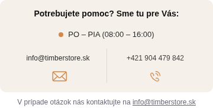

# Preview 0.6.11-rc.3 – kontaktné riadky a CTA

15. 10. 2026. Existujúca vetva `preview/mobile-shipping-layout-20261015`, základ `4e66dbce0de8fe8756e43687f6f46847311b09b6`. Predchádzajúce commity a tagy zachované, produkčný loader v0.6.9. Pripravené len izolované preview, bez merge, release tagu a produkčného nasadenia. Trello kód nebol dodaný; pokračuje autorizovaná preview práca.

## Kontakty – presné poradie

1. Nadpis hore a na stred.
2. Samostatné hodiny cez oba stĺpce, na stred, pôvodný indikátor zostáva.
3. E-mail vľavo, telefón vpravo, pôvodné mailto:/tel: anchors.
4. Pôvodné Apollo ikony pod textami, zarovnané na spoločný spodný riadok. Pôvodný jemný service-divider medzi oboma kontaktmi.

Existujúca grid/flex deklarácia je upravená priamo. Žiadne nové klony, presuny, náhrady natívnych interaktívnych prvkov alebo nth-child selektory. Pevné min-height existujúcich odkazov a stretch/space-between kontaktných obalov držia ikony na rovnakej úrovni aj pri dvojriadkovom texte na 320 px.

Doplnkový odsek je stále mimo béžového panelu. info@timberstore.sk zostáva jediný skutočný mailto: anchor a pri zalomení vety sa adresa nerozdelí. Checkout e-mail je mailto: na mobile aj desktope; pôvodné prepínanie na kontaktný formulár podľa breakpointu bolo odstránené iba tu. Hlavička mimo checkoutu a jej pôvodný desktopový kontaktný formulár zostávajú pôvodné. Nie je potrebný ďalší observer ani nové handlery.

## Upravené súbory

| Zdroj | Zmena |
|---|---|
| `src/modules/header-service-bar/header-service-bar.css` | Existujúci mobile grid, hodiny samostatne, e-mail vľavo, telefón vpravo, zarovnanie ikon, nowrap doplnkového mailto odkazu. Desktopová geometria bez zmeny. |
| `src/modules/header-service-bar/index.js` | Checkout e-mail vždy mailto:, nezávislý od breakpointu. Zvyšná logika a observer pôvodné. |
| `src/styles/overrides/cart-presentation.css` | Base a hover/active/focus CTA foreground biely, natívne pseudo šípky explicitne inherit, právna veta inherit; Emerald podklad nemeníme. |
| `src/styles/overrides/checkout.css` | Biely foreground plného aktívneho kroku a radio ticku; žiadna geometria progresu. Login radius/padding/min-height/centrovanie, pôvodné farby. Mobilný Osobné údaje radius napojený na rovnaký token bez zmeny hodnoty. |
| `src/styles/tokens.css` | Len nový geometrický token `--ts-radius-checkout-panel:8px`. Všetky farebné tokeny, vrátane Emerald #00c853 a Success Background #e8f5ed, zostávajú identické s rc.2. |
| `package.json`, `package-lock.json`, `scripts/build.mjs` | Manuálne rc.3, limit 20,25 KiB CSS iba rozšírený na novú verziu, staršie verzie bez zmeny. Nespustené release hooky. |
| `dist/timber.min.css`, `dist/timber.min.js`, obe sourcemapy | Rebuild na presné preview assets. |
| `CONTRIBUTING.md`, `CHANGELOG.md`, tento report a obrázok kontaktov | Dokumentácia rozsahu a overenia. |

Biely foreground sa týka plných Emerald plôch. ZADARMO, SKLADOM, odber benefit a ostatné success texty na svetlých/béžových plochách zostávajú zelené. Nepridáva sa plošný biely text do zhrnutia objednávky.

## Osobné údaje / prihlasovacie tlačidlo

Použitý je spoločný 8 px radius podľa existujúceho mobilného bloku Osobné údaje, padding 14 px 12 px, minimálna výška 48 px, inline-flex centrovanie a obmedzenie na šírku kontajnera. Tvar sa uplatňuje na login button v oboch zobrazeniach. Na desktope osobný nadpis ostáva nadpisom, nepridáva sa mu nové pozadie alebo wrapper. Žiadne zmeny polí, validácie, columns, mien ani odosielania osobného formulára.

## Overenie a praktické hranice

- Živý Shoptet/Apollo s lokálne substituovanými iba Timber CSS/JS: obrazovky **Doprava & platba** a **Osobné údaje a adresa**, každá pri **320/375/390/430/1024/1440 px**, spolu 12 scenárov. Bez horizontálneho overflow, kontakty v požadovanom poradí, pôvodné pseudo ikony dole, tel/mailto aj pomocný mailto odkaz, biele CTA labely a šípky.
- Natívny Shoptet má tri obrazovky: Môj košík, Doprava & platba a Osobné údaje a adresa. V URL ide o /kosik/, /objednavka/krok-1/ a /objednavka/krok-2/. Tým sú overené požadované kroky 2 a 3; neodosiela sa finálna objednávka.
- Login na živom osobnom formulári: radius **8px**, výška aspoň **48px**, padding **14px 12px**, centrovaný text na všetkých šiestich šírkach; mobilný osobný nadpis má rovnaký radius. Pôvodný prihlasovací anchor bol aktivovaný bez zadania prihlasovacích údajov, nenahradili sme jeho handler.
- Stavové CTA meranie používa Chromium CSS.forcePseudoState pre hover a active, aby sa neaktivovalo finálne objednávkové tlačidlo. Farby labelu/šípky biela rgb(255,255,255), podklad Emerald rgb(0,200,83). Natívne fyzické hover/screenshot actionability čakalo v headless prostredí na nestabilný rendering, preto sa netvrdí kompletný fyzický mobilný test.
- Lokálne natívne DOM modely s Apollo CSS/ikonovým fontom: 320/375/390/430 px; desktop 768/1024/1440 rovnaké rozmery a typografia kontaktov ako rc.2. E-mail na desktope teraz podľa zadania mailto:.
- Klonová výmena panelu a päť opakovaných inicializačných eventov: jeden pomocný riadok, jedny hodiny, žiadne vnorené anchors. Fyzické kliky v modeli dorazia na pôvodný tel:, hlavný mailto: aj pomocný mailto:; otvorenie externých aplikácií bolo pri teste preventDefault blokované.
- Modelové merania success cien, benefit/progress, stock, header status, radio, soft pozadia, CTA/právnej vety a order shadow statusu pri 390/1440 px prešli. Emerald/success background a oranžová/béžová ostávajú pôvodné z rc.2.
- Lint, build a diff whitespace kontrola prešli. Existujúci limit CSS 20,25 KiB a JS 30 KiB sa nenavyšuje.
- Pri natívnej navigácii bol zachytený už skôr pozorovaný Chromium DOMException „Transition was skipped“ bez Timber stacku; samotné layout/farebné kontroly prešli. Netvrdíme nulovú konzolu alebo úplný test natívnych view transitions.
- Reálny iOS Safari, platobná brána a finálne odoslanie objednávky sa netestovali. Osobné údaje ani prihlasovacie údaje sa nevypĺňali. Niektoré externé marketingové/provider zdroje blokuje testovacie prostredie. Presne požadovaná biela na Emerald má kontrast 2,24:1; farba sa svojvoľne nestmavuje a nejde o WCAG certifikáciu.
